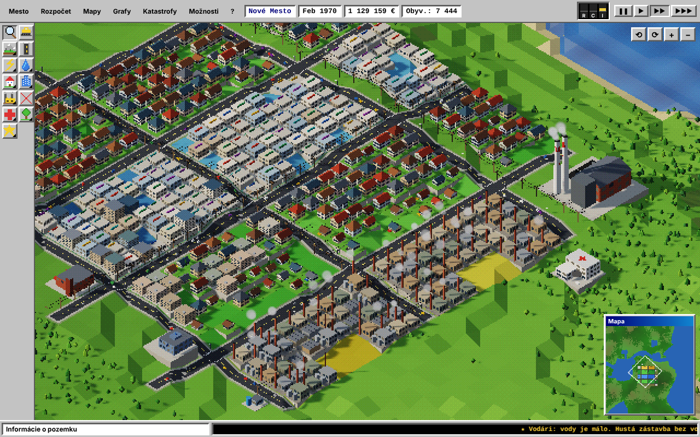

# Mestopolis 3D

Budovateľská simulácia mesta v prehliadači – klasická „izometrická“ hrateľnosť z 90. rokov
(zóny R/C/I, elektrina, voda, rozpočet, katastrofy) s vlastnou low-poly 3D grafikou vo WebGL
(Three.js), dynamickým svetlom deň/noc, tieňmi a retro pixelovým post-processingom.



## Spustenie

ES moduly nefungujú cez `file://`, treba lokálny server:

```bash
cd mestopolis
python3 -m http.server 8000
# otvorte http://localhost:8000
```

Nie sú potrebné žiadne závislosti – Three.js je pribalené vo `vendor/`.

## PWA (inštalovateľná aplikácia)

Hra je Progressive Web App: dá sa nainštalovať na plochu (počítač, Android, iPhone/iPad) a funguje **offline**.

- Inštalácia vyžaduje **HTTPS** (alebo `localhost`) – napr. GitHub Pages, Netlify, Cloudflare Pages.
- Chrome/Edge/Android: tlačidlo **⬇ Inštalovať** v hornej lište alebo ikona inštalácie v adresnom riadku.
- iPhone/iPad (Safari): Zdieľať → **Pridať na plochu**.
- Po zmene súborov zvýšte `VERSION` v `sw.js`, aby si nainštalované aplikácie stiahli novú verziu.

Dotykové ovládanie: 1 prst = nástroj (s info nástrojom posun mapy, ťuk = informácie), 2 prsty = posun a zoom.

## Hrateľnosť

- **Terén**: mapy 96–256 polí, kopce v terasách, more, rieky, jazerá, lesy; terraformovanie (zdvihnúť / znížiť / vyrovnať).
- **Zóny**: obytné, obchodné, priemyselné – riedke a husté. Budovy vyrastajú samé podľa dopytu (ukazovateľ R/C/I), hodnoty pozemku, znečistenia, kriminality, dopravy.
- **Infraštruktúra**: cesty (aj mosty), elektrické vedenie, vodovod (podzemný pohľad `U`). Zóny vedú prúd a vodu ďalej, cesty nie.
- **Elektrárne** podľa roku: uhoľná, vodná, plynová (1950), jadrová (1955), veterná (1980), solárna (2000), fúzna (2050).
- **Služby**: polícia, hasiči, nemocnica, škola, univerzita, parky, radnica, štadión, prístav, letisko, arkológia (2050).
- **Ekonomika**: dane po sektoroch, financovanie služieb, ročná bilancia, grafy.
- **Dátové mapy**: elektrina, voda, hodnota pozemkov, znečistenie, kriminalita, doprava, hustota, pokrytie službami.
- **Katastrofy**: požiare (šíria sa, hasiči pomáhajú), tornádo, zemetrasenie, havária jadrovej elektrárne.
- **Ukladanie**: localStorage (aj automatické), export/import do súboru.

## Ovládanie

| Akcia | Ovládanie |
|---|---|
| Použiť nástroj | ľavé tlačidlo (ťahaním cesty, vedenia, zóny) |
| Posun mapy | pravé/stredné tlačidlo, `WASD`, šípky, klik do minimapy |
| Zoom | koliesko, `+` / `-` |
| Otočiť pohľad | `Q` / `E` |
| Pauza / rýchlosť | `Medzera`, `1`–`3` |
| Buldozér / cesta / info | `B` / `R` / `Esc` |
| Mriežka / podzemie | `G` / `U` |
| Uložiť | `Ctrl+S` |

## Štruktúra

- `js/config.js` – budovy, ceny, nástroje
- `js/world.js` – dáta mapy, generovanie terénu, terraformovanie, stavanie, ukladanie
- `js/sim.js` – simulácia (siete, pokrytie, doprava, znečistenie, kriminalita, dopyt, rast, financie, katastrofy)
- `js/renderer.js` – Three.js scéna, terén, voda, bloky, svetlo deň/noc, retro post-process, častice, autá
- `js/buildgeo.js`, `js/geom.js` – procedurálne low-poly modely budov
- `js/ui.js`, `js/icons.js` – retro rozhranie, dialógy, pixel-art ikonky
